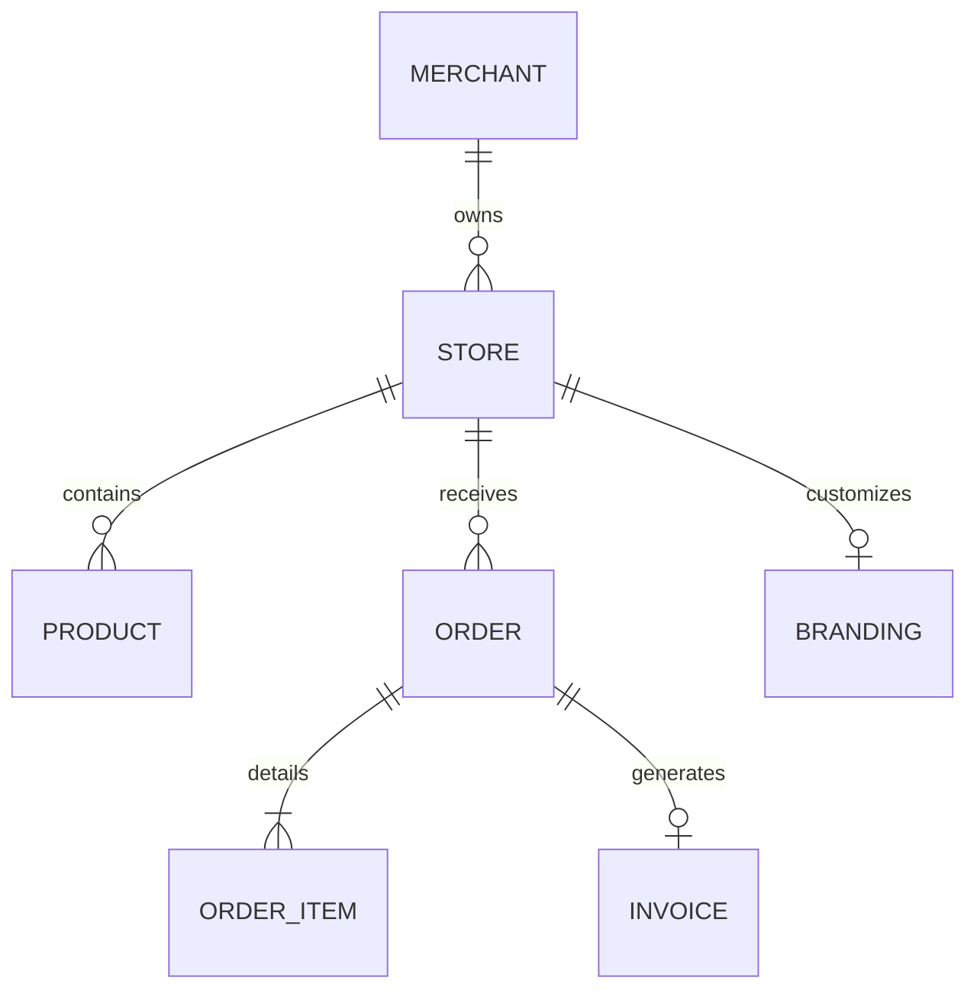

# 🗄️ Database Schemas & Data Flow

> **Subsystem Completion:** `90%`  
> **Status:** 🟢 Production Ready  
> **Primary Path:** `worker/migrations/`, `backend/src/models/`  
> **Parent:** [[00 - 🗺️ System Architecture Overview]] | **Progress:** [[01 - 📊 Progress & Completion Matrix]]

---

## 1. Dual-Database Design

## 2. Core Entities

| Entity | Primary Storage | Key Attributes |
| :--- | :--- | :--- |
| **Merchants** | Appwrite / Core DB | `id`, `email`, `phone`, `plan_id` (`free` \| `business` \| `pro`), `created_at` |
| **Stores** | D1 Edge SQL | `id`, `merchant_id`, `subdomain`, `custom_domain`, `currency`, `region` |
| **Products** | D1 Edge SQL | `id`, `store_id`, `name`, `price`, `stock`, `hsn_code`, `image_url` |
| **Orders** | Core DB / D1 Replica | `id`, `store_id`, `customer_phone`, `total_amount`, `status`, `payment_id` |
| **Invoices** | Core DB | `id`, `order_id`, `invoice_number`, `cgst`, `sgst`, `igst`, `pdf_url` |
| **Website Drafts** | D1 Edge SQL | `id`, `organization_id`, `user_id`, `draft_data`, `version`, `updated_at` |
| **Website Versions** | D1 Edge SQL | `id`, `organization_id`, `version_number`, `snapshot_data`, `published_at` |
| **Website Connections** | D1 Edge SQL | `id`, `organization_id`, `connection_type`, `config_json`, `secrets_encrypted` |
| **Announcements & Updates** | D1 Edge SQL / Core DB | `id`, `title`, `content`, `category`, `badge_label`, `action_url`, `is_pinned`, `target_plan`, `is_active`, `created_at` |

## 3. Migration Files
- `worker/migrations/`: SQL migration files for Cloudflare D1 (0001 through 0019).
  - `0019_unified_website_builder.sql`: Website drafts, immutable versions, connections vault, and media asset staging flags.
- `backend/src/models/`: TypeScript interfaces and Mongoose/SQL query definitions.

